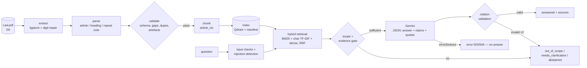

# Egyptian Civil Code RAG

Grounded question answering over the **Egyptian Civil Code (Law No. 131 of 1948)**: Arabic (MSA and Egyptian
colloquial) and English questions → hybrid retrieval over the article texts → **Gemini** generates an answer that may
only cite retrieved articles → every citation and quote is machine-checked before the answer is shown. When the
evidence is insufficient, the question is out of scope, or a dependency fails, the system says so instead of producing
a legal-sounding answer.

> ⚖️ **Not legal advice.** This is a research aid over the text available in its corpus. The current validity of each
> article and later amendments are *not* verified (see [Limits](#limits-and-legal-risks)).

> نظام بحث وإجابة موثقة بالمصادر على نصوص القانون المدني المصري. كل إجابة مرتبطة بأرقام مواد ونصوص مقتبسة يتم التحقق
> منها آلياً، والنظام يمتنع عن الإجابة بدلاً من الاختلاق. التقرير النهائي بالعربية: [`docs/FINAL_REPORT_AR.md`](docs/FINAL_REPORT_AR.md). دليل التشغيل خطوة بخطوة: [`docs/QUICKSTART_AR.md`](docs/QUICKSTART_AR.md).

| | |
|---|---|
| Audit of the reference project | [`docs/AUDIT_REPORT.md`](docs/AUDIT_REPORT.md) (Arabic) |
| Architecture & data flow | [`docs/ARCHITECTURE.md`](docs/ARCHITECTURE.md) |
| Data sources, rights, rebuild | [`docs/DATA_SOURCES.md`](docs/DATA_SOURCES.md) |
| Evaluation method & results | [`docs/EVALUATION.md`](docs/EVALUATION.md) · [`reports/EVALUATION_REPORT.md`](reports/EVALUATION_REPORT.md) |
| Deployment, rollback, resources | [`docs/DEPLOYMENT.md`](docs/DEPLOYMENT.md) |
| CI/CD | [`docs/CI_CD.md`](docs/CI_CD.md) |
| Monitoring & alerts | [`docs/MONITORING.md`](docs/MONITORING.md) · [`reports/PERFORMANCE_AND_MONITORING.md`](reports/PERFORMANCE_AND_MONITORING.md) |
| Security & threat model | [`docs/SECURITY.md`](docs/SECURITY.md) |

---

## Architecture (short)



## What is in the box

| Area | Implementation |
|---|---|
| Corpus | 1,149 article records (1,093 with text + 56 repealed per the source's own note), JSONL with provenance, hierarchy, status, content hash. Lam-alef ligature and digit-order corruption repaired; 7 source defects documented, none patched with invented text. |
| Retrieval | BM25 (light-stemmed Arabic), character n-gram TF-IDF, dense vectors in **Qdrant** (embedded or server), RRF hybrid, article-level de-duplication, exact lookup for "المادة N". Benchmarked over 22 configurations. |
| Generation | Gemini via `google-genai`, structured JSON output, versioned prompt (`configs/prompts/v1.yaml`), documents wrapped and escaped as untrusted data. |
| Grounding | evidence-sufficiency gate → model may abstain → **citation validator** (cited article ∈ context, quotes verbatim, no hallucinated "المادة N", repealed articles flagged) with one repair round, else abstain. |
| Outcomes | `answered · abstained · out_of_scope · needs_clarification · rejected · error` — failures are never turned into answers. |
| API | FastAPI: `/api/v1/ask`, `/api/v1/search`, `/api/v1/articles/{n}`, `/api/v1/info`, `/health`, `/ready`, `/metrics`; request ids, JSON logs (questions hashed by default), rate limiting, timeouts. |
| MLOps | DVC pipeline (extract → … → evaluate), MLflow tracking (23 runs logged), index manifest with compatibility checks, quality gate with baseline-regression detection. |
| Ops | Read-only non-root Docker image with the index built inside, compose profiles (Qdrant server, Prometheus/Grafana, MLflow), GitHub Actions CI + release with manual approval, Cloud Run deploy with smoke test and automatic rollback. |

## Quickstart (local)

Requirements: Python 3.12, [uv](https://docs.astral.sh/uv/) 0.11+, Git, a Gemini API key for `/ask`. The source PDF is in
the repository (`data/raw/Law.pdf`, see [`docs/DATA_SOURCES.md`](docs/DATA_SOURCES.md) for provenance and rights).

```bash
git clone <repo-url> ecc-rag && cd ecc-rag
make setup                                   # uv sync --frozen (dev + pipeline + mlops extras)
source .venv/bin/activate
cp .env.example .env                         # set GEMINI_API_KEY (and nothing secret anywhere else)

# data: rebuild everything from the committed PDF (sha256 checked against configs/source.yaml)
dvc repro index                              # extract → parse → validate → chunk → index

make test                                    # unit + integration + e2e (127 tests: 126 pass, 1 skipped without GEMINI_API_KEY)
make eval                                    # offline evaluation → reports/*.json + MLflow run
make gate                                    # quality gate vs reports/baseline/
make serve                                   # http://127.0.0.1:8000/docs
```

Try it:

```bash
curl -s localhost:8000/ready
curl -s -X POST localhost:8000/api/v1/ask -H 'Content-Type: application/json' \
     -d '{"question": "ما هو سن الرشد في القانون المدني المصري؟", "include_diagnostics": true}'
curl -s -X POST localhost:8000/api/v1/search -H 'Content-Type: application/json' \
     -d '{"question": "مسئولية حارس الحيوان", "top_k": 3}'
curl -s localhost:8000/api/v1/articles/176
```

### Response shape (`POST /api/v1/ask`)

```jsonc
{
  "request_id": "6f1c…",
  "status": "answered",                    // abstained | out_of_scope | needs_clarification | rejected | error
  "answer": "… [م 44]",
  "reason": null,                          // e.g. "insufficient_evidence", "article_not_in_corpus", "llm_timeout"
  "message": null,
  "citations": [{"statement": "…", "articles": [44], "quotes": ["وسن الرشد هى إحدى وعشرون سنة ميلادية كاملة"], "kind": "stated"}],
  "sources": [{"article_number": 44, "citation": "القانون المدني المصري، المادة 44", "source_page": 6,
               "legal_status": "unverified", "text": "(١) كل شخص بلغ سن الرشد …", "rank": 1}],
  "notices": ["تنبيه: هذه أداة مساعدة للبحث …"],
  "latency_ms": 1834.2
}
```

The JSON above illustrates the **schema**; an example produced by the real system without an LLM key:
`{"status": "error", "reason": "llm_unavailable", "answer": null, "sources": [...]}` with HTTP 503.
HTTP codes: 200 for every domain outcome, 422 invalid input, 429 rate-limited, 503 LLM/vector-store/index unavailable,
504 timeout, 502 unusable LLM output.

## Docker

```bash
make docker-build                             # needs data/processed/*.jsonl (dvc pull); index is built inside the image
make docker-run                               # read-only, non-root, port 127.0.0.1:8000, secrets from .env
make smoke URL=http://127.0.0.1:8000
docker compose up -d                          # API only (embedded Qdrant)
docker compose --profile monitoring up -d     # + Prometheus :9090 + Grafana :3000 (set GRAFANA_ADMIN_PASSWORD)
docker compose --profile qdrant up -d         # API backed by a Qdrant server (:8001)
docker compose --profile mlflow up -d         # MLflow server :5000
```

Required to run the API: the image + `GEMINI_API_KEY` (or `LLM_PROVIDER=none` for a retrieval-only deployment, in which
`/ask` answers `503 llm_unavailable`). Optional: Qdrant server, Prometheus/Grafana, MLflow.

## Results (measured, 2026-10-17 — see [`reports/EVALUATION_REPORT.md`](reports/EVALUATION_REPORT.md))

Golden set `golden_v1`: 241 questions (191 answerable, 50 negative/boundary), deterministic dev/test split, authored and
checked against the source text, **not lawyer-reviewed**.

| | dev R@5 | dev MRR | test R@5 | test MRR |
|---|---|---|---|---|
| Reference project's corpus + hybrid retrieval (baseline) | 0.661 | 0.515 | 0.749 | 0.666 |
| **This system** (repaired corpus, `article_ctx`, hybrid) | **0.750** | **0.625** | **0.819** | **0.680** |

- MSA questions R@5 0.849; **Egyptian-colloquial scenarios 0.385** (weakest area); English 1.000 (n=4).
- Decision layer (no LLM), test split: accuracy 0.941, balanced accuracy 0.763, 24 % of negatives still reach the LLM
  (second gate), 0 % of answerable questions blocked.
- Load (2 vCPU container, LLM disabled): `/search` p50 15.5 ms at 1 user, ~80 req/s peak, 0 errors up to 32 users.
- **Generation quality with Gemini (RAGAS, citation accuracy, abstention with the LLM) was not measured** — the build
  environment had no access to the Gemini API. `make eval-llm` produces it; the quality gate then includes it.

## Limits and legal risks

- Source: an unofficial bilingual PDF (2019 export) referenced by the course handbook; consolidation date and current
  validity unknown → every article has `legal_status = unverified` except the 56 the source itself marks as repealed.
- 7 documented source defects (e.g. Arabic text of Art. 1022 missing, Art. 812 has missing words) — kept as printed.
- Laws outside the Civil Code (penal, personal status, labour, rent-control, tax, procedure) are out of scope.
- The rule-based scope gate over-fits its dev split; the LLM and the citation validator are the next lines of defence.
- Neural embeddings (`gemini-embedding-001`, e5, bge-m3) and the cross-encoder are implemented but **not benchmarked**.

## Known issues

See [`docs/FINAL_REPORT_AR.md`](docs/FINAL_REPORT_AR.md) §13–15 for the full list (unimplemented items, risks, manual setup).

## Repository layout

```
src/ecc_rag/{data_pipeline,rag,api,evaluation,monitoring}   application code
configs/        rag.yaml (versioned RAG params), prompts/, quality_gates.yaml, source.yaml, known_source_issues.yaml
data/           evaluation/golden_v1.yaml (in Git) · raw/ processed/ index/ (DVC only)
tests/          unit/ (synthetic fixtures) · integration/ · e2e/ (real corpus)
reports/        generated JSON/MD results (benchmark, eval, gates, data quality, load test, MLflow export)
docker/ deploy/ .github/workflows/   container, Prometheus/Grafana, CI/CD
baselines/reference_pipeline/        reference project's extraction code, kept only to measure the baseline
```

Code license: Apache-2.0 ([`LICENSE`](LICENSE)). The legal corpus is **not** covered by that license — see
[`docs/DATA_SOURCES.md`](docs/DATA_SOURCES.md).
