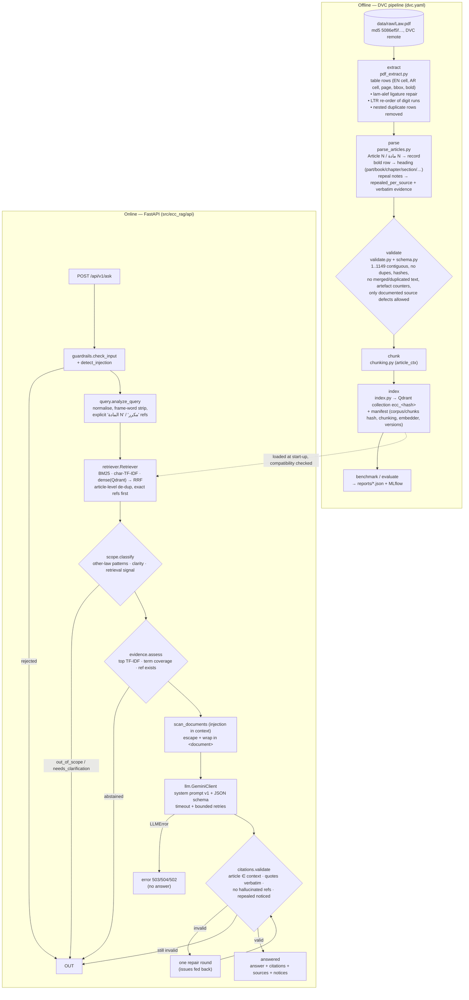

# Architecture

## 1. Data flow: from the legal source to the final answer



Every stage is a separate module with one responsibility; the API layer only orchestrates and maps outcomes to HTTP.

## 2. Components

| Module | Responsibility | Key decisions |
|---|---|---|
| `data_pipeline/pdf_extract.py` | Table-cell extraction with geometry | PyMuPDF `find_tables` + `rawdict`; ligature fix by zero-width alef detection; digits sorted by x |
| `data_pipeline/parse_articles.py` | Rows → article records | English header authoritative for numbering (`A?rticle` tolerates the missing "A" of Art. 452); Arabic number cross-checked |
| `data_pipeline/validate.py` | Data contract | fails on anything not documented in `configs/known_source_issues.yaml` |
| `data_pipeline/chunking.py` | Retrieval units | `article_ctx` chosen by benchmark; exception paragraphs never split from their rule |
| `rag/embeddings.py` | Embedders | `lsa` (offline, deterministic), `gemini`, `sentence_transformers`; identity hashed into the manifest |
| `rag/vector_store.py` | Qdrant wrapper | embedded (single process) or server; one collection per index version |
| `rag/index.py` | Build/load + compatibility | refuses to serve on any corpus/chunks/config/embedder/count/dim mismatch |
| `rag/retriever.py` | BM25, TF-IDF, dense, RRF | article-level aggregation; explicit refs honoured; optional cross-encoder |
| `rag/scope.py`, `rag/evidence.py` | Pre-generation gates | thresholds calibrated on dev only |
| `rag/guardrails.py` | Input + document injection checks | layered; documented as non-exhaustive |
| `rag/llm.py` | Gemini client | typed errors, structured output schema, no fallback answer |
| `rag/citations.py` | Output validation | deterministic checks; heuristic support check labelled as such |
| `rag/pipeline.py` | Orchestration + outcome taxonomy | status/reason pairs are the contract with the API and metrics |
| `evaluation/*` | Benchmark, offline eval, gate calibration, LLM eval, quality gate, human review | numbers come only from runs |
| `monitoring/*` | Prometheus metrics, JSON logs | quality metrics only from offline runs |

## 3. Versioning and lineage

```
Law.pdf (md5/sha256)  ──►  articles.jsonl (content_hash per record → corpus_hash)
                                │
configs/rag.yaml ── chunking ──►  chunks.jsonl (chunks_hash)
                 ── embedding ─►  embedder identity (name, model, version, dim, params_hash)
                                │
                                ▼
          data/index/manifest.json {corpus_hash, chunks_hash, chunking, embedder, collection, git_commit, libraries}
                                │  load_index() refuses any mismatch  → /ready = 503
                                ▼
          reports/eval_summary.json {git_commit, dataset_hash, corpus_hash, index_collection, rag_config_hash}
                                │  quality_gate: eval corpus_hash must equal index corpus_hash
                                ▼
          MLflow run (params = rag.yaml, tags = git commit / dataset hash / corpus hash / collection)
```

The Docker image builds its own index from `data/processed/*.jsonl` during `docker build`, so an image can never carry
an index from another corpus version.

## 4. Rebuilding everything from scratch

```bash
git clone <repo> && cd <repo> && make setup && source .venv/bin/activate
dvc remote add -d --local storage <remote>   # or place Law.pdf at data/raw/Law.pdf (sha256 in configs/source.yaml)
dvc pull data/raw/Law.pdf.dvc
dvc repro                       # extract → parse → validate → chunk → index → reference_baseline → benchmark → evaluate
make test gate
make docker-build
```

`articles.jsonl` and `chunks.jsonl` are byte-identical across runs (verified twice, md5 `8137e1c7…` / `971e66b8…`).
The Qdrant storage directory is not byte-identical (it embeds timestamps) but is semantically identical: same
manifest hashes, same retrieval results (checked locally vs. inside the container).

## 5. Why no token streaming

Answers are released only after citation validation. Streaming tokens would show unvalidated text that might later be
withdrawn. A future SSE endpoint could stream *progress events* (retrieval done → validated answer) without this risk.

## 6. Scaling notes

- Embedded Qdrant = one process per container (one uvicorn worker). Scale out with replicas + `QDRANT_URL`
  (compose profile `qdrant`).
- Retrieval is CPU-bound (~80 req/s on 2 vCPU); LLM latency dominates end-to-end time and is the real capacity limit.
- The in-process rate limiter is per replica; enforce global limits at the gateway.
